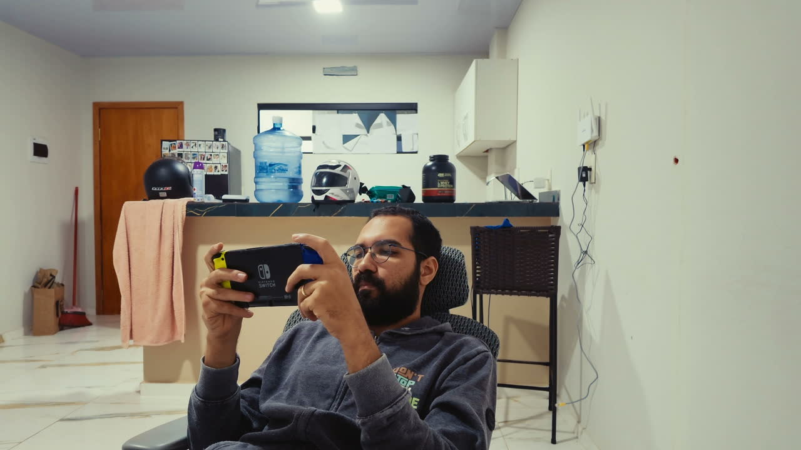

# osmo-pocket-4-on-switch

<p align="center">
  
</p>

See and steer a **DJI Osmo Pocket 4** from a **Nintendo Switch**.



```
Osmo Pocket 4 (USB webcam) ──USB-C──▶ Mac ──Wi-Fi──▶ Switch (Osmo Remote.nro)
                                       │
                                 UVC Pan/Tilt
```

The Mac does two jobs: it captures the Pocket's UVC video and serves it as MJPEG,
and it translates the Switch's stick input into **UVC Pan/Tilt Absolute** commands
for the gimbal. The Switch side is a single homebrew NRO with an in-stream settings
overlay.

No Switch-side SDK for the camera exists, so the Mac is the bridge.

## Features

- Live view on the Switch, fullscreen 1280×720
- Gimbal control from the sticks / D-pad, with 6 speed levels (0.5×–3.0×)
- In-stream settings overlay: resolution, FPS, quality, speed
- Latency handling: frame draining on both ends plus frame pacing
- MTP installer so you never have to eject the SD card

## Requirements

| | |
|---|---|
| Mac | Apple Silicon, macOS 14+ |
| Switch | Atmosphère + hbmenu (any recent CFW) |
| Software | `ffmpeg` (`brew install ffmpeg`), `libmtp` (`brew install libmtp`) |
| Build | Docker (only to compile the NRO) |
| Network | Mac and Switch on the same Wi-Fi (guest networks isolate clients) |

## Quick start

### 1. Mac

Put the Pocket in **webcam / UVC** mode and plug it in over USB-C.

```fish
git clone https://github.com/sostenesapollo/osmo-pocket-4-on-switch
cd osmo-pocket-4-on-switch

./scripts/build-ptzctl.sh     # once: builds the gimbal helper
python3 mac/stream_server.py  # serves http://YOUR_IP:8765/
```

Open `http://YOUR_IP:8765/` in a browser. If you see the picture, the Mac side is done.

**Keep GimbalBar closed** while this runs — both apps claim the same UVC device.

To keep it alive across terminal sessions, install it as a LaunchAgent (see
`docs/launchagent.md`).

### 2. Switch

```fish
./scripts/build-nro.sh          # compiles with Docker (devkitA64)
./scripts/install-to-switch.sh  # copies via DBI MTP
```

On the Switch: **DBI → Run MTP responder**. The installer writes:

- `sdmc:/switch/osmo-remote.nro`
- `sdmc:/switch/osmo-remote-host.txt` (contains `YOUR_IP:8765`)

Leave MTP, then **hbmenu → Osmo Remote → A**.

## Controls

### Idle screen

| Button | Action |
|---|---|
| A | connect / start the stream |
| B | exit |
| − | bump the last octet of the IP |
| X | reload `host.txt` |
| Y | save `host.txt` |

### While streaming

| Button | Action |
|---|---|
| Left stick | pan + tilt (right stick adds to it) |
| ZL / ZR | fast movement |
| D-pad | fine adjustment |
| X | recenter the gimbal |
| **+** | **settings overlay** |
| B | close overlay, or stop streaming |

### Settings overlay (`+`)

| Item | Options |
|---|---|
| Resolution | 640×360 · 960×540 · 1280×720 |
| FPS | 24 · 25 · 30 |
| Quality | 3 · 5 · 8 · 12 · 18 (lower = better) |
| Speed | 0.5× · 0.8× · 1.0× · 1.5× · 2.2× · 3.0× |

`<` `>` change · `A` accepts · `X` restores defaults · `Y` turbo preset · `B` closes.
Changes apply immediately: the Switch calls the Mac's `/config`, which restarts
ffmpeg with the new profile.

## HTTP API (Mac)

| Route | Purpose |
|---|---|
| `/stream` | MJPEG multipart stream |
| `/snapshot.jpg` | one frame |
| `/config` | read / change resolution, fps, quality, presets |
| `/ptz/state` | current pan/tilt and range |
| `/ptz?dx=5&dy=0` | relative move, in degrees |
| `/ptz?action=center` | recenter |
| `/info` | server config |

## How it works

**Gimbal.** The Pocket exposes the standard UVC Pan/Tilt Absolute control
(camera terminal 1, VideoControl interface 0, selector `0x0D`). `mac/ptzctl.c`
sends `GET_CUR` / `GET_MIN` / `GET_MAX` / `SET_CUR` through IOKit. libusb cannot do
this on macOS because the system UVC driver owns the interface. The reported range
on the Pocket 4 is pan −38°…215°, tilt −45°…94°.

**Video.** ffmpeg grabs the UVC device and emits MJPEG over a pipe. The Python
server keeps only the newest frame and hands it to any connected client.

**Latency.** Three things had to be fixed, and all three matter:

1. The MJPEG queue repeated the same frame many times. `/stream` now drains and
   sends only the most recent one.
2. The Switch read one frame per loop and fell behind. The NRO drains the socket
   with `MSG_DONTWAIT` and draws only the last complete JPEG.
3. The render loop had no pacing, so it free-ran and the backlog rebuilt. The NRO
   now waits for the frame interval (`1000/fps` ms).

## Field notes

Things that cost real debugging time:

- **`framebufferBegin()` returns `stride` in bytes**, not pixels. Treating it as
  pixels produces gray banding and torn lines.
- **The Pocket 4 UVC only advertises 24/25/30 fps.** Any other value makes ffmpeg
  fail to open the device with *"Selected framerate is not supported"*. If the
  server restarts in a loop, that is why.
- **The Pocket 4 offers only 1080p / 4K over UVC.** There is no 720p source mode;
  the Mac downscales.
- **avfoundation delivers frames in bursts.** ffmpeg can report ~2500 fps with
  heavy duplication. The `fps=` filter regularizes the output; without it the pipe
  stalls after the first frames.
- **`svcGetSystemTick()` counts at 19.2 MHz.** Frame pacing needs
  `frame_us × 19.2` ticks. Getting this wrong by 1000× caps the app at ~1 fps.
- **DBI refuses MTP writes into a freshly created subfolder**, and refuses to
  overwrite an existing file. The installer deletes the same-name file first and
  writes directly into `sdmc:/switch/`.
- **A charge-only USB-C cable negotiates power but never enumerates data.** If the
  Mac's IO registry shows `TransportsActive = ("CC")` with no `USB2`/`USB3`, it is
  the cable or the connector, not software.

## Credits

- Gimbal control reuses `ptz.c` / `ptz.h` from
  [GimbalBar](https://github.com/amirmxt/gimbalbar) by amirmxt (MIT).
- JPEG decoding: [stb_image.h](https://github.com/nothings/stb) (public domain).
- Overlay text: [stb_easy_font.h](https://github.com/nothings/stb) (public domain).
- Switch homebrew: [devkitPro](https://devkitpro.org) and
  [libnx](https://github.com/switchbrew/libnx).

Details in [CREDITS.md](CREDITS.md).

## Disclaimer

Homebrew only. It talks to your own camera over your own network. Nothing here
touches Nintendo services. Use at your own risk.

## License

MIT — see [LICENSE](LICENSE).
